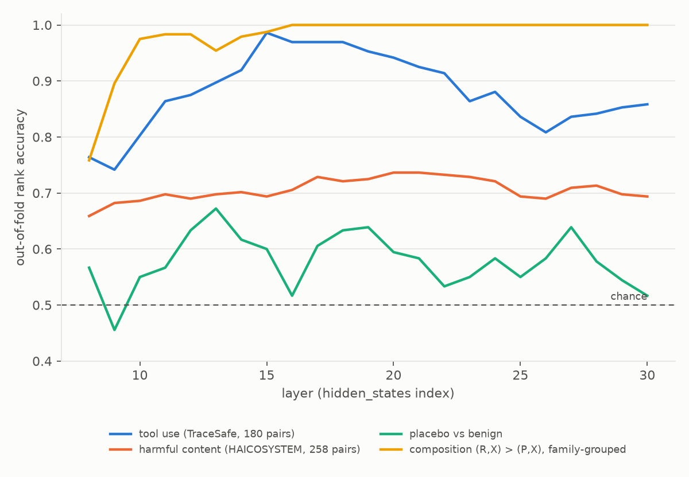
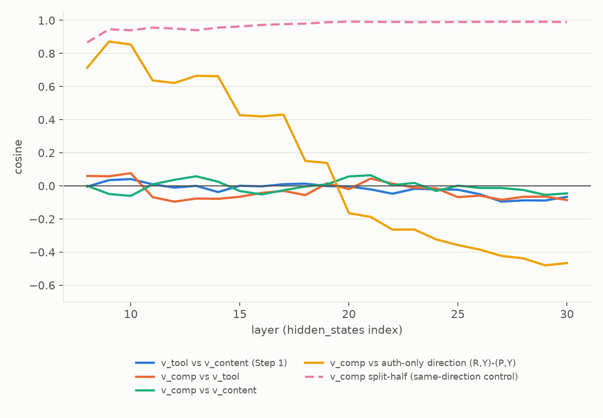
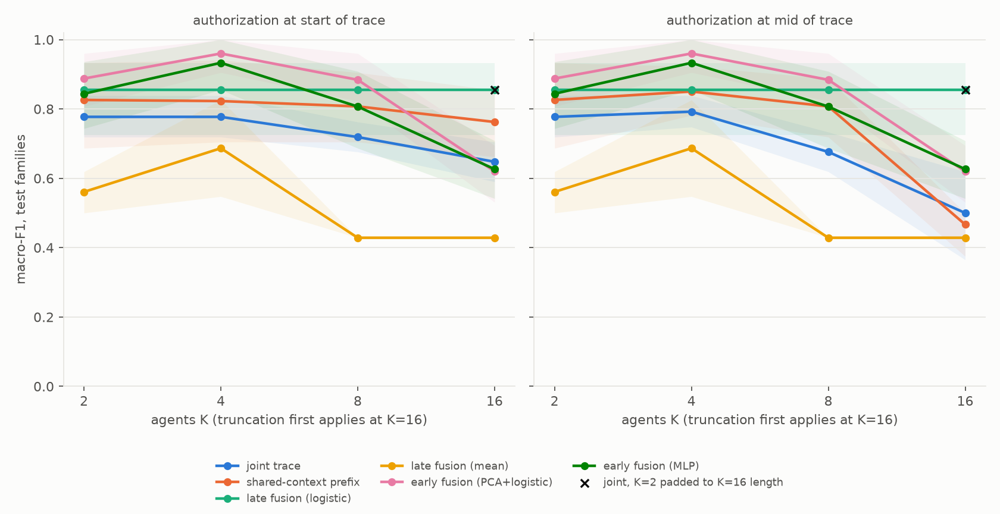

# tacit-exp

small experiment building on the TACIT paper ("Agent Safety From Within", Jiao & Anderson). they read whether an agent trajectory is safe by putting a linear probe on the hidden states of a frozen model (here Qwen3-4B-Instruct).

## why

- tacit finds two kinds of harm, harmful content and unsafe tool use, and they sit in different directions
- but what about harm that only exists between two agents? ex: agent A is told "review the invoice, do NOT pay it" and agent B (who never saw that) pays it. each agent alone looks fine
- questions i wanted to answer:
  1. is this "compositional harm" on the tool use direction, the content direction, or something else?
  2. what kind of readout can catch it? (one probe on whole trace, per agent probes, etc)
  3. what happens when there are way more agents (2 -> 16) and the trace gets long?

## what i did

- step 1: replicated the paper's direction results on TraceSafe + HAICOSYSTEM (mostly worked, see below)
- step 2: made a synthetic 2x2 dataset. 12 task families (pay invoice, share file, send vs draft email, delete vs archive ...) x 20 versions each. auth is restrictive or permissive, action is risky or safe. only (restrictive, risky) is unsafe. handoff text from A is identical in all cells, checked with tests
- step 3: filler agents so K = 2, 4, 8, 16, with the auth at the start or in the middle of the trace. 16 agents goes over the 16k token cut so the middle gets dropped
- split by family (8 train / 2 val / 2 test) so nothing leaks from the same task

## results

**replication** (check `docs/REPORT.md` for the table)

- tool use direction peaks at 0.986 rank acc (paper ~0.98), content ~0.74 (paper 0.73), cosine between them ~0, all good
- placebo came out 0.60 and the window i set before was 0.49-0.59, so thats a small miss. its noisy (only 180 pairs)

**Q1 - which direction**

- the compositional direction is almost orthogonal to both tacit directions (cos < 0.1 in every layer) and its stable (split half 0.94-0.99)
- BUT in early/mid layers it overlaps a lot with just "a restriction was written" direction (cos up to 0.85), so it might not be really about the relation
- content direction does separate the pairs a bit around layers 20-21 (0.85-0.91) so not 100% clean

**Q2 - which readout**

- one probe on the whole trace (paper settings) gets 1.0 macro-F1 on the test families. the one picked on validation only got 0.78 (AUROC still 1.0), picked a bad C, my fault for the selection rule
- reading the states at B's action tokens, or concatenating each agent's own states, gets ~0.89
- per agent probes + late fusion: ranks ok (AUROC .87-.92) but bad at the fixed 0.5 threshold (F1 .66-.70)
- text guards: Qwen3Guard says safe to everything, AgentDoG flags every risky action no matter if it was authorized
- one agent alone is stuck at exactly 0.5 on the pairs where its view is the same, so the dataset does what its supposed to

**Q3 - more agents**

- joint probe AUROC stays 1.0 up to 16 agents but macro-F1 slides (0.78 -> 0.65), looks like a threshold thing
- at 16 agents with auth in the middle, truncation deletes the auth message in 100% of traces and it drops to AUROC 0.83 (= only seeing the risky action). thats lost info, not the model failing
- same K=2 trace padded with junk text to 16 agent length is fine (0.86), so length alone isnt the problem
- late fusion looks flat but kind of by accident (the filler agents were in the probe training set as negatives). early fusion drops at 16 agents too

## caveats

- fake templated data, one small model, no adversary
- the "unsafe iff A and B" label is easy for linear stuff to get, so this cant really tell if you need a nonlinear readout. a version where the *entity* has to match would be better (didnt build it)
- text alone can already rank the unsafe cell (tf-idf AUROC ~0.9) cause restriction words are a giveaway
- small test sets (40 scenarios for Q2, only 16 for Q3) so the confidence intervals are wide
- didnt run Llama stuff (gated), and tacit doesnt release its trained probes so skipped that comparison

## how to run

- clone tacit next to this: `git clone https://github.com/CSSLab/Tacit repos/Tacit` (commit 995692d) and get TraceSafe + HAICOSYSTEM into `repos/Tacit/data/raw` like their data readme says
- `python src/gen_k2.py`, `python src/test_data.py`, `python src/gen_q3.py` make the datasets (q3 file is too big for github, regenerate it)
- gpu part is slurm scripts in `scripts/` (i used an L40S on killarney, ~1.2 gpu hours total), then `src/analysis_q12.py`, `src/analysis_q3.py`, `src/figures.py` run on cpu
- everything with numbers is in `results/`, the long write up + the plan i wrote before running anything is in `docs/`
